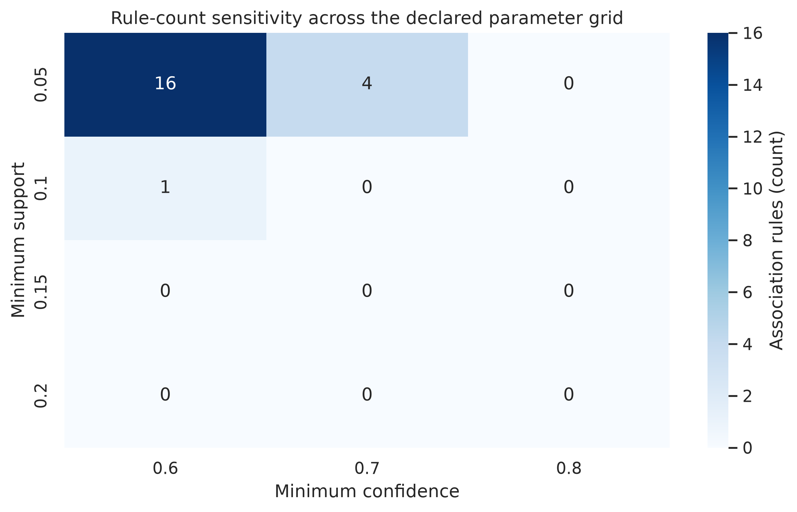
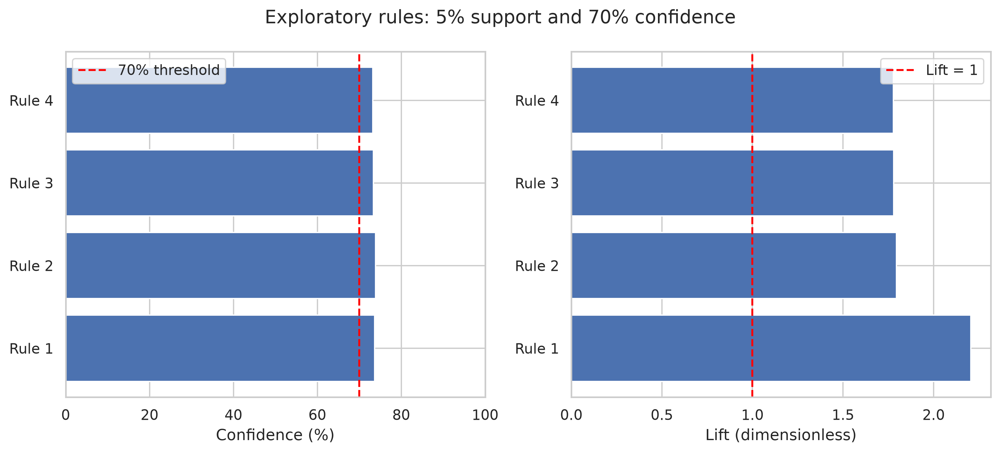

# FP-Growth association mining

## Purpose and observation unit

We mine co-occurring characteristics of historical prison systems using the 437 selected state-year profiles from 35 jurisdictions during 2001–2013. Each transaction contains exactly five items: an occupancy band and one cohort-relative tertile for each of undertrial, female, age-18–30 and illiterate shares. There are 15 possible items and 159 distinct item patterns. Repeated patterns are retained because they represent different state-years. Neither state/year identifiers nor native counts enter the item vocabulary. Support refers to profiles, not prisoners or independent states.

The [executed notebook](../notebooks/04_FP_Growth.ipynb) runs the analysis and generates its charts directly. The [source module](../src/mining/fp_growth.py) provides reusable loading, mining, serialization and verification functions. Raw and prepared inputs are preserved.

## Representation and mining methodology

We reuse the frozen Phase 3 transformations rather than fitting new bins. Occupancy is within_capacity for x ≤ 1, over_100_to_150pct for 1 < x ≤ 1.5, and over_150pct for x > 1.5. Demographic tertiles use the saved lower/upper boundaries with equality assigned to the lower interval. For example, `illiterate_share=upper_tertile` means a share above approximately 0.338157 in this cohort; it is not an official severity classification. Exact definitions are in [transformation parameters](../results/tables/transformation/parameters.json) and the [transformation report](data_transformation.md).

We use the validated mlxtend 0.25.0 FP-Growth implementation: item frequencies order an FP-tree, shared prefixes compress transactions, and conditional pattern bases/trees recursively yield frequent itemsets. The itemset search has no length cap; the representation permits at most five items from distinct feature families. The small search space allows independent exhaustive checking without replacing the required FP-Growth algorithm.

For disjoint, nonempty antecedent A and consequent C:

- Support = count(A ∪ C) / 437.
- Confidence = count(A ∪ C) / count(A).
- Lift = confidence / support(C).
- Leverage = support(A ∪ C) − support(A) × support(C).

Lift above one indicates positive empirical co-occurrence relative to the marginal frequencies; confidence alone can be misleading when the conclusion is common. These metrics do not establish statistical significance or causality.

## Parameters and baseline result

Before the first mining run, we specified support settings 0.05, 0.10, 0.15 and 0.20 and confidence settings 0.60, 0.70 and 0.80. The baseline was support **0.10** and confidence **0.70**. A minimum support threshold s corresponds to ceil(437 × s) supporting transactions; comparisons are inclusive. The four minimum counts are 22, 44, 66 and 88.

The baseline yields **75 frequent itemsets**, with a maximum length of two, and **zero rules** meeting 70% confidence. The empty [baseline rules table](../results/tables/fp_growth/association_rules.csv) is an intentional result, not a failed run. A threshold-independent claim of strong associations is therefore unsupported. The most frequent two-item pattern is lower-tertile illiterate share with within-capacity occupancy: 87 profiles (19.91% support). The next is upper-tertile female share with within-capacity occupancy: 73 profiles (16.70%). Their joint frequency alone does not establish 70% directional confidence.

The lower-support **0.05 / 0.70** setting from the declared grid yields **four rules** and is reported separately as exploratory after observing the baseline. It requires at least 22 joint profiles. The most permissive declared combination, 0.05 / 0.60, yields 16 rules. We retain every confidence-qualified rule for every combination, with no lift filter in the complete exports. Short, single-consequent rules with lift > 1 are separately selected for interpretation. All four exploratory rules meet that interpretation criterion. Threshold settings are analyst assumptions, not optimized predictive hyperparameters.

## Parameter comparison

| min_support | min_count | min_confidence | itemsets | max_itemset_length | rules | positive_lift_rules |
| --- | --- | --- | --- | --- | --- | --- |
| 0.05 | 22 | 0.6 | 166 | 3 | 16 | 16 |
| 0.05 | 22 | 0.7 | 166 | 3 | 4 | 4 |
| 0.05 | 22 | 0.8 | 166 | 3 | 0 | 0 |
| 0.1 | 44 | 0.6 | 75 | 2 | 1 | 1 |
| 0.1 | 44 | 0.7 | 75 | 2 | 0 | 0 |
| 0.1 | 44 | 0.8 | 75 | 2 | 0 | 0 |
| 0.15 | 66 | 0.6 | 23 | 2 | 0 | 0 |
| 0.15 | 66 | 0.7 | 23 | 2 | 0 | 0 |
| 0.15 | 66 | 0.8 | 23 | 2 | 0 | 0 |
| 0.2 | 88 | 0.6 | 15 | 1 | 0 | 0 |
| 0.2 | 88 | 0.7 | 15 | 1 | 0 | 0 |
| 0.2 | 88 | 0.8 | 15 | 1 | 0 | 0 |

Reducing support from 20% to 5% increases the frequent-itemset count from 15 to 166; maximum length increases from one to three. Raising confidence never adds rules for a fixed support. The absence of larger frequent sets and high-confidence rules at stricter thresholds is itself informative about the limited categorical regularity of these profiles.



The heatmap compares rule counts, not accuracy. It displays the entire declared grid, including settings with zero output.

## Exploratory rule interpretations

1. **female_share=middle_tertile + occupancy_ratio=over_150pct → illiterate_share=upper_tertile.** Both sides occur in 28 of 437 profiles (6.41% support). Of 38 profiles satisfying the premise, 28 also satisfy the conclusion (73.68% confidence). The conclusion appears in 146 profiles overall (33.41%); lift is 2.205, and leverage is 0.0350. The joint pattern spans 8 jurisdictions and 12 distinct years. This is a pooled association, not a causal relationship or a held-out prediction.

2. **female_share=upper_tertile + illiterate_share=lower_tertile → occupancy_ratio=within_capacity.** Both sides occur in 34 of 437 profiles (7.78% support). Of 46 profiles satisfying the premise, 34 also satisfy the conclusion (73.91% confidence). The conclusion appears in 180 profiles overall (41.19%); lift is 1.794, and leverage is 0.0344. The joint pattern spans 8 jurisdictions and 13 distinct years. This is a pooled association, not a causal relationship or a held-out prediction.

3. **illiterate_share=lower_tertile + undertrial_share=upper_tertile → occupancy_ratio=within_capacity.** Both sides occur in 33 of 437 profiles (7.55% support). Of 45 profiles satisfying the premise, 33 also satisfy the conclusion (73.33% confidence). The conclusion appears in 180 profiles overall (41.19%); lift is 1.780, and leverage is 0.0331. The joint pattern spans 8 jurisdictions and 12 distinct years. This is a pooled association, not a causal relationship or a held-out prediction.

4. **age_18_30_share=upper_tertile + illiterate_share=lower_tertile → occupancy_ratio=within_capacity.** Both sides occur in 41 of 437 profiles (9.38% support). Of 56 profiles satisfying the premise, 41 also satisfy the conclusion (73.21% confidence). The conclusion appears in 180 profiles overall (41.19%); lift is 1.777, and leverage is 0.0410. The joint pattern spans 10 jurisdictions and 13 distinct years. This is a pooled association, not a causal relationship or a held-out prediction.



Rule numbers follow the list above, ordered by descending lift. Percentage confidence and dimensionless lift use separate panels. All four rules have two-item premises and one-item conclusions. Three have within-capacity occupancy as their conclusion. This does not mean that any demographic composition causes lower occupancy.

## Validation and reproducibility

The JSON transaction arrays are decoded against every Boolean membership row and their profile identifiers. Input hashes are checked against the frozen transformation manifest. Every transaction contains one item from each family; no same-family contradictory combination can occur.

There are 4^5 − 1 = **1,023** family-compatible nonempty itemsets, of which **911** have positive observed support. Direct counting verifies complete frequent-itemset membership and exact support at all four support thresholds. For every frequent union, all nonempty proper antecedents are enumerated independently to verify the complete confidence-qualified rule set. Support, marginal supports, confidence, lift and leverage are checked against integer transaction counts at all **12 parameter combinations**. Tests additionally enumerate all 1,023 admissible itemsets directly from the Boolean matrix, including zero-support combinations.

A separate nine-transaction fixture checks the worked example’s singleton counts (6, 7, 6, 2, 2), the two occurrences of {I1,I2,I5}, and the rule {I1,I5} → {I2} with confidence 1 and lift 9/7. Failure tests detect altered metrics and omitted itemsets/rules; empty high-threshold results and inclusive support boundaries are also checked. These example transactions are algorithm tests only, never a replacement dataset.

Run from the repository root:

```bash
.venv/bin/python -m src.mining.fp_growth
.venv/bin/python -m src.utils.execute_notebook notebooks/04_FP_Growth.ipynb
.venv/bin/python -m unittest discover -s tests -q
```

The notebook is the route for regenerating both mining tables and figures. The module alone regenerates the mining tables. There is no random sampling or algorithmic random seed in this deterministic mining workflow. Serialized itemsets and rule sides are sorted JSON arrays, and table ordering is stable. The [run summary](../results/tables/fp_growth/run_summary.json) records dependency versions, inputs, parameters, observation scope and validation outcomes.

## Outputs

All mining tables are under [results/tables/fp_growth](../results/tables/fp_growth/):

- `frequent_itemsets.csv` and `association_rules.csv`: baseline 10% / 70% results.
- `itemsets_s*.csv`: all four support settings.
- `rules_s*_c*.csv`: complete rule exports for all twelve settings.
- `parameter_comparison.csv`: itemset lengths, output counts and positive-lift counts.
- `exploratory_rules.csv`: complete 5% / 70% rules.
- `interpretable_rules.csv` and `occupancy_rules.csv`: explicitly filtered exploratory interpretation views.
- `run_summary.json`: configuration, provenance and exact-count validation.

The completed verification records **56 passing project tests**, **8 executed notebook code cells**, two directly generated inline charts, unchanged hashes for **85 raw/prepared input files**, and identical mining-table hashes on repeat execution. See [verification.json](../results/tables/fp_growth/verification.json) for artifact hashes and image dimensions.

## Limitations

Repeated years from the same jurisdiction are related observations, and longer-covered jurisdictions receive greater weight. We report distinct state/year coverage of each joint rule to expose concentration, but do not treat those counts as independent evidence. Geographic coverage and cohort selection restrict generalization. Quantile binning loses numeric detail, and cohort-wide cut points support descriptive analysis of this fixed cohort only. Rules were mined and interpreted on the same observations; no held-out predictive accuracy or future forecasting claim is made. Multiple rules can overlap, and choosing a lower-support interpretation setting after inspecting the baseline introduces exploratory selection. No p-values, significance, stability or causal claims are made.

MAFIA, clustering and Spark comparisons remain future phases. These small-data outputs do not establish a performance enhancement from distributed processing.

## References

- Course Lecture 6, *Apriori & FP growth*, and Lecture 7, *FPTrace* (local teaching materials).
- [mlxtend FP-Growth documentation](https://rasbt.github.io/mlxtend/user_guide/frequent_patterns/fpgrowth/).
- [mlxtend association-rules documentation](https://rasbt.github.io/mlxtend/user_guide/frequent_patterns/association_rules/).
- [Original Indian Prison Statistics dataset](https://www.kaggle.com/datasets/rajanand/prison-in-india).
