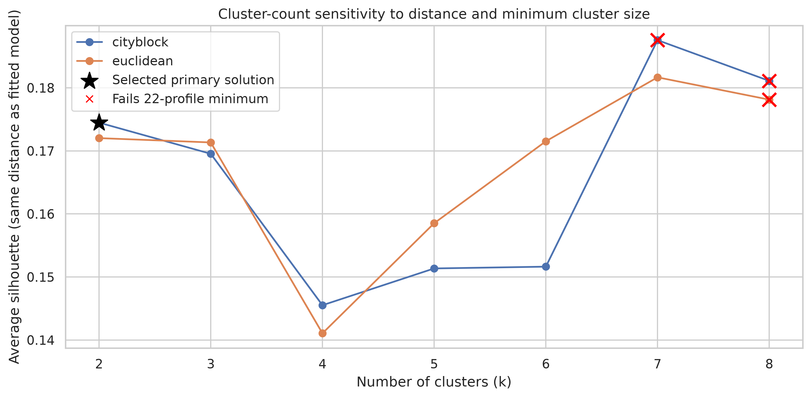
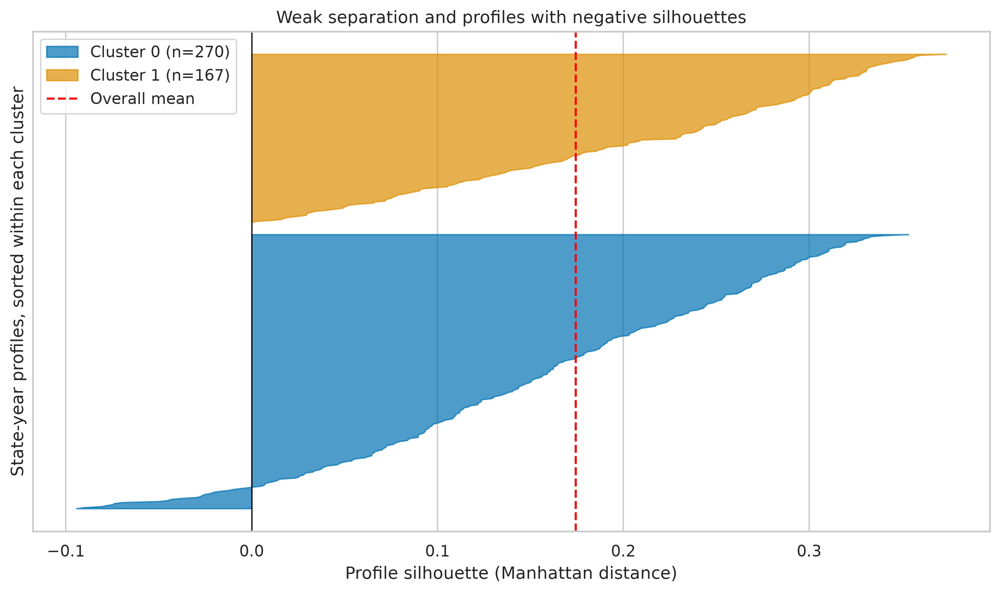
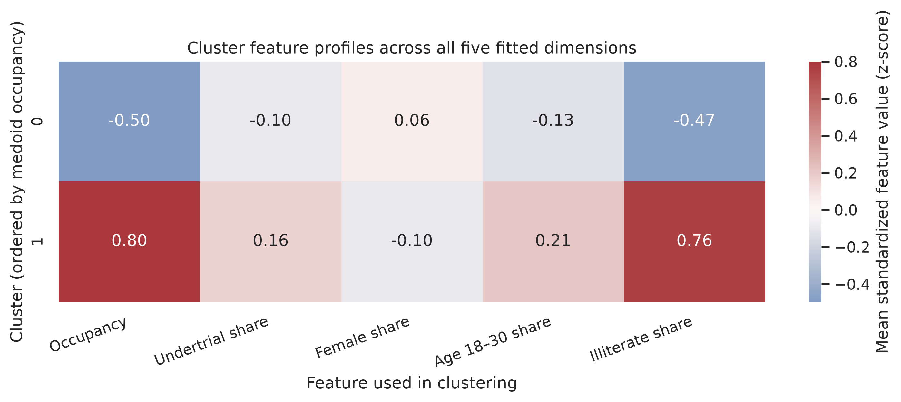
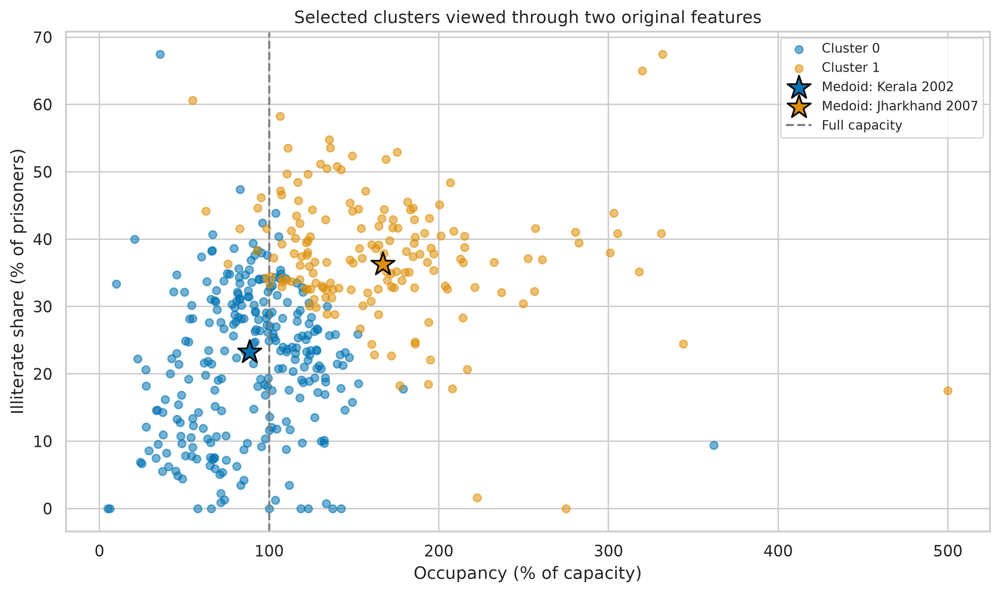
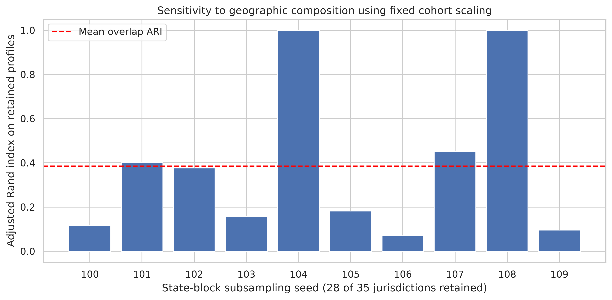

# K-Medoids clustering of state-year prison profiles

## Purpose and algorithm choice

We group the 437 selected historical state-year profiles using their five standardized characteristics: occupancy ratio, undertrial share, female share, age-18–30 share and illiterate share. The dataset contains aggregate counts and capacities rather than a natural, independently observed classification label. K-Medoids therefore fits the exploratory task better than inventing a target for Naive Bayes. We implement only K-Medoids for this assignment choice.

The medoids are real observations. Cluster membership describes a state in a particular year, not an individual prisoner or a permanent property of a jurisdiction. Clusters can contain multiple years of the same state. We do not compute classification accuracy, a confusion matrix or a dendrogram: these are not appropriate outputs for this partitioning task.

See the [executed notebook](../notebooks/05_Classification_or_Clustering.ipynb) and [PAM source module](../src/mining/k_medoids.py). Every figure below is generated directly by plotting code in the notebook, then saved at 300 dpi.

## Inputs, scaling and distances

We reuse the exact frozen Phase 3 z-score vectors, with the recorded feature order and full-cohort means/population standard deviations. We do not refit the scaler during model selection. All five features have equal weights in standardized units. State, year, profile ID, raw counts and transaction bins are excluded from distance calculations. [Transformation parameters](../results/tables/transformation/parameters.json) identify the fit scope and formulas. Original ratio features are retained for interpretation.

Manhattan (L1, `cityblock`) is fixed as the primary distance: d(x,y) = Σ|x_j−y_j|. It measures additive feature differences and avoids the squared-error objective of K-Means. Euclidean (L2) distance is a declared sensitivity setting on the same z-score vectors. A K-Medoids Euclidean objective sums distances, not squared distances. Neither choice removes the influence that extreme values have on fitted standard deviations. We retain all validated profiles and do not claim immunity to outliers.

We evaluate within-cluster similarity and between-cluster separation using the selected distance. The PAM references below define the BUILD/SWAP procedure used in the implementation.

## Faithful PAM implementation

For a medoid set M, we minimize J(M) = Σ_i min_{m∈M} d(x_i,x_m). Greedy BUILD starts with the observation minimizing total distance and adds the observation giving the lowest new objective. SWAP evaluates every exchange of one medoid for one nonmedoid, performs the best improving exchange, and repeats. Nearest and second-nearest distances vectorize the same full swap evaluation. A direct full-reassignment implementation independently verifies every candidate swap of the final solution. The accepted tolerance is 1e−10 objective units; the iteration limit is 100 accepted swaps, with an error rather than a false convergence claim if further improvement remains.

We use BUILD and four random starts (seeds 42, 43, 44, 45) for each candidate. Random starts replace BUILD initialization only; all runs use the same exhaustive best-swap stage. The lowest-objective converged run is retained for each distance/k. Ties follow stable profile/candidate ordering, and final cluster IDs are reordered by increasing raw occupancy of their medoids. Zero-distance medoid ties assign each medoid to itself. PAM reaches a one-swap local optimum; a global optimum for the actual dataset is not established.

## Cluster-count selection and sensitivity

Before evaluating candidates, we specify k = 2,…,8 and a minimum cluster size of ceil(0.05 × 437) = **22 profiles**. The size constraint is an analyst choice for broad profile groups, not a universal clustering rule. It avoids choosing a tiny group solely to improve internal separation. Among primary-distance candidates satisfying it, we select the largest average silhouette; an exact score tie favors smaller k. For fixed k we choose by PAM objective across starts, not by cherry-picking the best silhouette start. The rule and all rejected candidates are retained in the outputs.

For a profile, the silhouette is (b−a)/max(a,b), where a is average within-cluster distance and b the lowest average distance to another cluster. We use the same distance matrix as the fitted model, including every profile. It measures internal separation, not accuracy against known labels. An objective curve alone is insufficient for selecting k because fitting more medoids tends to lower cost.

| metric | k | silhouette | min_cluster_size | eligible | mean_start_ari |
| --- | --- | --- | --- | --- | --- |
| cityblock | 2 | 0.1745 | 167 | True | 0.3298 |
| cityblock | 3 | 0.1695 | 90 | True | 0.4345 |
| cityblock | 4 | 0.1455 | 90 | True | 0.5466 |
| cityblock | 5 | 0.1514 | 56 | True | 0.6527 |
| cityblock | 6 | 0.1516 | 42 | True | 0.5166 |
| cityblock | 7 | 0.1876 | 18 | False | 0.9199 |
| cityblock | 8 | 0.1811 | 18 | False | 0.802 |
| euclidean | 2 | 0.172 | 172 | True | 0.3882 |
| euclidean | 3 | 0.1713 | 85 | True | 0.4307 |
| euclidean | 4 | 0.1411 | 73 | True | 0.6143 |
| euclidean | 5 | 0.1585 | 66 | True | 0.5228 |
| euclidean | 6 | 0.1715 | 28 | True | 0.7515 |
| euclidean | 7 | 0.1817 | 26 | True | 0.748 |
| euclidean | 8 | 0.1781 | 19 | False | 0.9388 |

The selected primary model is **k=2**, with average silhouette **0.174477**, objective **1459.862365**, and average distance to medoid **3.340646**. Separation is weak. Of 437 profiles, **23** (5.26%) have negative silhouettes.

Without the size constraint, the highest Manhattan silhouette is at **k=7** (0.187562), but its smallest cluster has only **18 profiles**. We disclose this rather than claiming that k=2 is an unrestricted optimum. The eligible Euclidean choice is **k=7** (0.181665), showing that cluster-count selection also depends on distance. At the same selected k=2, Manhattan and Euclidean partitions have adjusted Rand index (ARI) **0.866802**. Objective magnitudes across different distance metrics are not directly comparable.





## Actual medoids and cluster interpretation

Medoid values below are expressed as percentages for readability. Source CSVs retain the original ratios. A medoid is an actual representative observation, not an average or an ideal prison system.

| cluster | profile_id | occupancy_ratio (%) | undertrial_share (%) | female_share (%) | age_18_30_share (%) | illiterate_share (%) |
| --- | --- | --- | --- | --- | --- | --- |
| 0 | Kerala|2002 | 88.55 | 66.65 | 3.6 | 43.25 | 23.21 |
| 1 | Jharkhand|2007 | 167.03 | 67.26 | 3.66 | 46.57 | 36.25 |

Cluster medians (not medoid values) are:

| cluster | Occupancy (%) | Undertrial (%) | Female (%) | Age 18–30 (%) | Illiterate (%) |
| --- | --- | --- | --- | --- | --- |
| 0 | 90.74 | 64.55 | 3.58 | 44.11 | 22.92 |
| 1 | 160.38 | 67.33 | 3.68 | 47.35 | 37.22 |

**Cluster 0: relatively lower occupancy and illiterate share.** It contains 270 state-year profiles (61.78%), spanning 32 jurisdictions and all 13 years. The actual medoid is Kerala–2002. Cluster medians are 90.74% occupancy, 64.55% undertrial share, 3.58% female share, 44.11% age-18–30 share and 22.92% illiterate share. Average within-cluster silhouette is 0.157; 22 profiles have negative silhouettes. These are relative aggregate descriptions, not labels of people or fixed state categories.

**Cluster 1: relatively higher occupancy and illiterate share.** It contains 167 state-year profiles (38.22%), spanning 27 jurisdictions and all 13 years. The actual medoid is Jharkhand–2007. Cluster medians are 160.38% occupancy, 67.33% undertrial share, 3.68% female share, 47.35% age-18–30 share and 37.22% illiterate share. Average within-cluster silhouette is 0.203; 1 profiles have negative silhouettes. These are relative aggregate descriptions, not labels of people or fixed state categories.

The strongest contrasts in the retained grouping concern occupancy and illiterate share. Female-share medians differ little. No feature was selected using the final cluster labels, and interpretation does not convert demographic attributes into individual risk scores. A jurisdiction can contribute to both clusters across years; counts of represented jurisdictions therefore overlap.





The heatmap shows mean standardized values across all five fitted features. The scatter displays only two original features for interpretation; its appearance cannot validate separation in the full five-dimensional distance space. Stars mark the actual medoids.

## Stability assessment

We report initialization sensitivity over all ten pairs of the five starts at the selected k. Mean pairwise ARI is **0.329846**, with minimum **0.066091**. One random k=2 start has silhouette 0.221798 but a worse objective (1477.694046 versus 1459.862365); it is not substituted for the objective-best run. This substantial variation indicates different local partitions, even though the lowest-objective observed start is retained. ARI compares assignments up to label permutation; it is not classification accuracy.

We also repeat descriptive state-block subsampling ten times with seeds 100–109. Each sample retains 80% of the 35 jurisdictions without replacement (**28 jurisdictions**), preserving all selected years for those states. For each subset we refit the same k using BUILD plus two recorded random starts and compare assignments on retained profiles with the full-data labels. We use the frozen full-cohort scaler and do not refit feature transformations. This assesses sensitivity to geographic composition, not held-out performance or an independently validated test set.

Mean overlap ARI is **0.385181**, ranging from **0.069192** to **1.000000**. Together with the low silhouette, this argues against treating the two groups as stable natural classes. The useful output is an exploratory summary with transparent limits.



## Verification and reproducibility

We validate nonnegative, finite, symmetric distance matrices with zero diagonals; unique, real medoid indices; nearest-medoid assignments; monotonically decreasing accepted objective values; convergence; and exact saved feature/identity alignment. A hand-checkable six-point example is compared with all possible two-medoid sets and yields objective 4 with medoids at 1 and 11. Full reassignment verifies the optimized swap-cost table on small examples and all swaps of the selected real solution. Duplicate/tied observations, invalid distances/indices and unfinished convergence are tested explicitly. Test fixtures are not replacement project data.

The algorithm follows PAM as documented in R's cluster reference and the Schubert–Rousseeuw paper. R is not installed here; we do not claim an executed cross-language comparison. Instead, the independent brute-force checks verify the implemented objective and swap semantics. No additional Python dependency is needed beyond the pinned NumPy, SciPy, pandas and scikit-learn environment.

Run from the project root:

```bash
.venv/bin/python -m src.mining.k_medoids
.venv/bin/python -m src.utils.execute_notebook notebooks/05_Classification_or_Clustering.ipynb
.venv/bin/python -m unittest discover -s tests -q
```

The notebook regenerates both tables and its inline figures. The module alone regenerates tables. [run_summary.json](../results/tables/k_medoids/run_summary.json) records seeds, candidate range, stopping rules, feature order, versions, medoid IDs, selection assumptions, stability scope and transformed-input hashes. No speedup or benchmark claim is made in this phase.

The completed audit records **62 passing tests**, **10 executed notebook code cells**, five inline-generated figures, identical table hashes on repeat execution, and unchanged hashes for **85 raw/prepared inputs** plus recorded earlier-phase outputs. See [verification.json](../results/tables/k_medoids/verification.json) for table/image hashes and dimensions.

## Output tables

Under [results/tables/k_medoids](../results/tables/k_medoids/):

- `cluster_assignments.csv`: all profiles, original features, cluster ID, representative ID, distance and silhouette.
- `medoids.csv`: the actual selected representative profiles and original feature values.
- `cluster_sizes.csv`, `cluster_feature_summary.csv`, `cluster_standardized_means.csv`: group sizes, raw-feature statistics and standardized means.
- `candidate_k_comparison.csv`: all 14 distance/k settings and eligibility.
- `initialization_runs.csv`: all 70 starts, initial/final medoids, objectives, swaps and ARI to the retained run.
- `objective_trace.csv`: every accepted step of the selected fit.
- `state_block_stability.csv`: ten geographic-composition perturbations.
- `state_cluster_counts.csv`, `year_cluster_counts.csv`: assignment coverage, not transition probabilities.

## Limitations and conclusion

The selected clusters overlap and are sensitive to initialization and geographic composition. They describe a fixed historical cohort, with repeated and related years per state. Equal weighting gives more-covered states greater influence. Full-cohort scaling and model selection on the same data support descriptive exploration only. The candidate range, 5% size rule, feature choice and distance are assumptions, not uniquely correct settings. Z-score scaling remains influenced by extreme observations. PAM's local search and five starts do not prove global optimality.

We retain k=2 as the declared-rule result while disclosing the higher-scoring excluded k=7 candidate and the Euclidean sensitivity. Kerala–2002 and Jharkhand–2007 are interpretable real representatives, but neither names an invariant class of states. The academically defensible conclusion is weak, exploratory grouping rather than strong predictive structure. MAFIA and both PySpark phases remain unimplemented.

## References

- Course Lecture 20, *Clustering*, and Lecture 22, *Similarity Measures* (local teaching materials).
- [R cluster package: PAM methodology](https://stat.ethz.ch/R-manual/R-devel/library/cluster/html/pam.html).
- Schubert and Rousseeuw (2021), [Fast and eager k-medoids clustering](https://wis.kuleuven.be/statdatascience/robust/papers/publications-2021/schubertrousseeuw-fastpam-infsystems-2021.pdf).
- [scikit-learn silhouette score](https://scikit-learn.org/stable/modules/generated/sklearn.metrics.silhouette_score.html) and [adjusted Rand score](https://scikit-learn.org/stable/modules/generated/sklearn.metrics.adjusted_rand_score.html).
- [Data transformation report](data_transformation.md) for feature formulas, scaling and fit scope.
