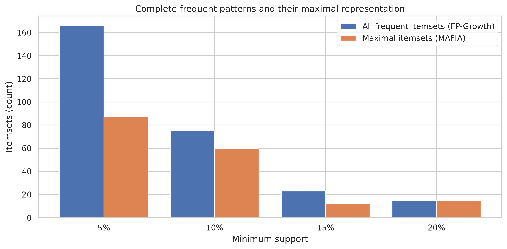
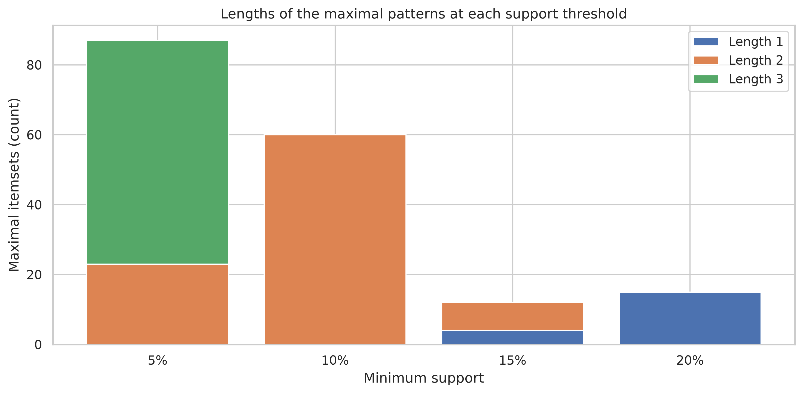
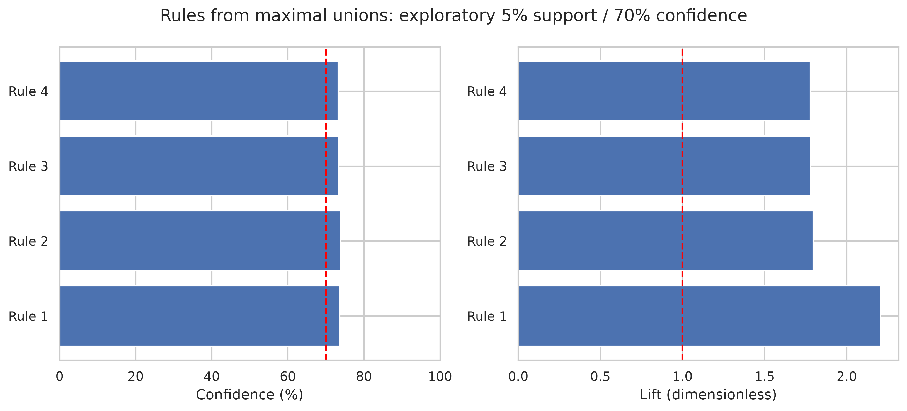
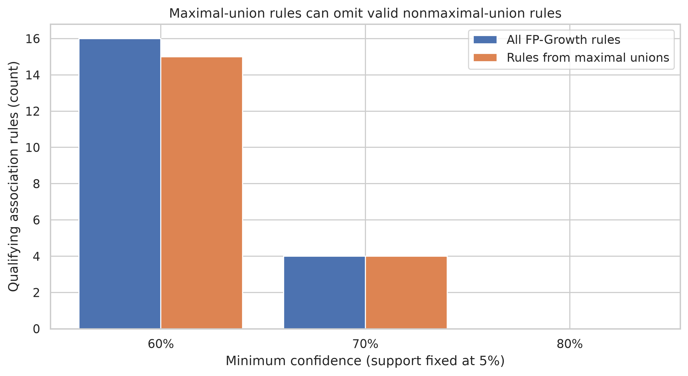
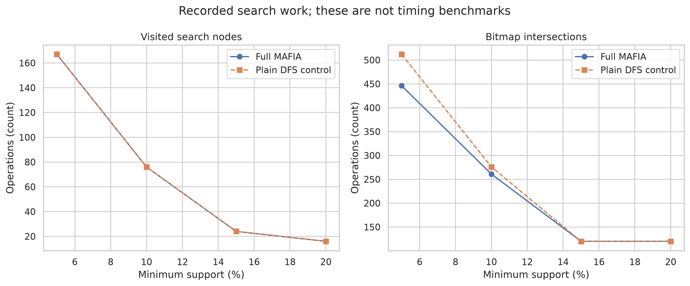

# MAFIA: maximal frequent itemsets and rules from maximal unions

## Purpose and definitions

We apply MAFIA to the same **437 state-year transactions**, **15-item vocabulary** and frozen five-item representation used in Phase 6. Support remains the fraction of these state-year profiles, not prisoners, crime incidents or independent states. No source data or discretization parameters are changed.

A frequent itemset meets the support threshold. It is **maximal** if no proper superset is frequent. By downward closure, checking all one-item extensions is sufficient to verify maximality. A **closed** frequent itemset has no proper superset with the same support; maximal and closed are different concepts. Maximal sets preserve frequency membership but not exact subset supports.

The assignment's phrase “maximal association rules (MFIs)” combines two objects: MFIs are itemsets, whereas association rules have disjoint antecedent/consequent sides. We report MFIs and **rules whose unions are maximal itemsets**, with exact subset supports recounted from the transactions. We do not claim an irredundant rule basis, a special maximal-rule ordering, or the complete rule family from maximal unions alone.

The [executed notebook](../notebooks/06_MAFIA.ipynb) generates all analysis and figures directly. The [source module](../src/mining/mafia.py) provides the algorithm and verification functions.

## MAFIA implementation

We follow the combined search in Burdick, Calimlim and Gehrke (2001), Figure 5, with vertical bitmaps and depth-first head/tail nodes. Each Python integer has one bit per transaction; AND forms intersections and `bit_count` counts support. Parent-equivalence pruning moves equal-transaction-set children into the head. Children are trimmed and reordered by increasing support. HUTMFI skips a node when its head-union-tail is contained in an already found maximal candidate. FHUT propagates a successful leftmost-path HUT check to skip sibling subtrees. We preserve whether the original untrimmed HUT was frequent. An inclusion-antichain repository discards dominated candidates.

This implementation uses fixed transaction positions, not the paper's adaptive relative-bitmap compression or a specialized MFI index. Those representation optimizations are omitted; the search and pruning conditions are retained. Python integer storage and frozenset subset checks suit this small dataset. FP-Growth, `fpmax`, Pincer Search and post-filtering all frequent patterns are not substituted for MAFIA mining. FP-Growth and exact enumeration are used only for independent comparison/validation after MAFIA returns.

The algorithm's code maps to its mechanisms as follows:

| Mechanism | Code evidence | Verification |
|---|---|---|
| Vertical support counting | `vertical_bitmaps`, integer AND and population count | Direct Boolean/set counts |
| Head/tail depth-first search | nested `search` routine | Exhaustive small item universes |
| Parent-equivalence pruning | `child == bitmap`, move item to head | Long-itemset fixture; ablation |
| FHUT | first-child HUT return value, skip remaining sibling branches | Dense fixture with actual skipped siblings |
| HUTMFI | head-union-tail containment in maintained MFI candidates | Random exhaustive fixtures and ablation |
| Dynamic ordering | ascending support, item-name tie break | Output equivalence with ordering disabled |
| MFI repository | suppress subsets and remove dominated candidates | Antichain/completeness comparisons |

## Parameters and actual output

We retain Phase 6's support grid **5%, 10%, 15%, 20%** and confidence grid **60%, 70%, 80%**, with inclusive support counts **22, 44, 66, 88**. The baseline remains **10% support / 70% confidence**. The lower-support **5% / 70%** setting remains explicitly exploratory; no threshold is changed to make MAFIA look better.

| min_support | min_confidence | fp_frequent_itemsets | maximal_itemsets | max_mfi_length | fp_all_rules | maximal_union_rules | omitted_fp_rules |
| --- | --- | --- | --- | --- | --- | --- | --- |
| 0.05 | 0.6 | 166 | 87 | 3 | 16 | 15 | 1 |
| 0.05 | 0.7 | 166 | 87 | 3 | 4 | 4 | 0 |
| 0.05 | 0.8 | 166 | 87 | 3 | 0 | 0 | 0 |
| 0.1 | 0.6 | 75 | 60 | 2 | 1 | 1 | 0 |
| 0.1 | 0.7 | 75 | 60 | 2 | 0 | 0 | 0 |
| 0.1 | 0.8 | 75 | 60 | 2 | 0 | 0 | 0 |
| 0.15 | 0.6 | 23 | 12 | 2 | 0 | 0 | 0 |
| 0.15 | 0.7 | 23 | 12 | 2 | 0 | 0 | 0 |
| 0.15 | 0.8 | 23 | 12 | 2 | 0 | 0 | 0 |
| 0.2 | 0.6 | 15 | 15 | 1 | 0 | 0 | 0 |
| 0.2 | 0.7 | 15 | 15 | 1 | 0 | 0 | 0 |
| 0.2 | 0.8 | 15 | 15 | 1 | 0 | 0 | 0 |

At baseline, MAFIA returns **60 maximal pairs**, compared with **75** complete frequent itemsets from FP-Growth: a 20% reduction in itemset count. No rules reach 70% confidence, matching the Phase 6 baseline. The most frequent maximal pair is lower-tertile illiterate share with within-capacity occupancy: **87 profiles (19.91% support)**.

At 5% support, MAFIA returns **87 maximal sets**, compared with **166** complete frequent sets: **23 pairs and 64 triples**, or a 47.59% reduction in output itemset count. The most frequent maximal triple combines upper-tertile age-18–30 share, lower-tertile illiterate share and within-capacity occupancy, with **41 profiles (9.38% support)**. Maximal means no frequent extension at this threshold, not highest support, highest confidence or largest size across all thresholds.

At 15% support there are **12 MFIs** (four singletons and eight pairs); at 20% support all **15 MFIs are singletons**. MFI counts need not decrease monotonically as support rises: removing frequent supersets can make their previously nonmaximal subsets maximal. The complete frequent-itemset count still decreases across these thresholds.





These comparisons concern output itemsets, not compressed file sizes, memory consumption or measured runtime.

## Rules and required support recounting

For each MFI M with at least two items, we enumerate every nonempty proper A ⊂ M and set C = M − A. We recount support(A), support(C) and support(M) using the original vertical transaction bitmaps. Confidence = count(M)/count(A), lift = confidence/[count(C)/437], and leverage = count(M)/437 − [count(A)/437][count(C)/437]. We retain every qualifying rule, including any multi-item consequent, and compare the matching rule family with FP-Growth.

The [exploratory recount table](../results/tables/mafia/exploratory_recounted_supports.csv) records **166 distinct supports** requested across maximal unions and their rule partitions. In this small dataset, these collectively restore every frequent subset's support at 5%. Consequently, the smaller MFI output does not imply a smaller end-to-end rule-generation support table. Subsets of frequent maximal sets are frequent, but their exact counts cannot be inferred from maximal-set counts.

At 5% support and 70% confidence, **four maximal-union rules** qualify. They happen to match all four Phase 6 exploratory rules at this setting. This agreement does not establish that maximal-union rules are generally complete.

1. **female_share=middle_tertile + occupancy_ratio=over_150pct → illiterate_share=upper_tertile.** The maximal union occurs in 28 profiles (6.41% support); the antecedent occurs in 38 profiles. Recounted confidence is 73.68% and lift is 2.205. The joint pattern spans 8 jurisdictions and 12 years. This describes pooled profile co-occurrence, not individual outcomes or a causal relationship.

2. **female_share=upper_tertile + illiterate_share=lower_tertile → occupancy_ratio=within_capacity.** The maximal union occurs in 34 profiles (7.78% support); the antecedent occurs in 46 profiles. Recounted confidence is 73.91% and lift is 1.794. The joint pattern spans 8 jurisdictions and 13 years. This describes pooled profile co-occurrence, not individual outcomes or a causal relationship.

3. **illiterate_share=lower_tertile + undertrial_share=upper_tertile → occupancy_ratio=within_capacity.** The maximal union occurs in 33 profiles (7.55% support); the antecedent occurs in 45 profiles. Recounted confidence is 73.33% and lift is 1.780. The joint pattern spans 8 jurisdictions and 12 years. This describes pooled profile co-occurrence, not individual outcomes or a causal relationship.

4. **age_18_30_share=upper_tertile + illiterate_share=lower_tertile → occupancy_ratio=within_capacity.** The maximal union occurs in 41 profiles (9.38% support); the antecedent occurs in 56 profiles. Recounted confidence is 73.21% and lift is 1.777. The joint pattern spans 10 jurisdictions and 13 years. This describes pooled profile co-occurrence, not individual outcomes or a causal relationship.



Three rules conclude within-capacity occupancy; one concludes upper-tertile illiterate share. Their interpretation is restricted to these fixed cohort bins. No demographic composition is asserted to cause occupancy, and confidence is not prediction accuracy.

## A concrete omitted rule

At **5% support / 60% confidence**, complete FP-Growth yields **16 rules**, but maximal unions yield **15**. The omitted rule is:

**occupancy_ratio=over_150pct → illiterate_share=upper_tertile**

It has **62/437 = 14.19% support**, **62/97 = 63.92% confidence**, and **1.913 lift**. Its two-item union has four frequent triple extensions and is therefore not maximal at 5% support. Each containing maximal triple is recorded in [omitted_fp_rules.csv](../results/tables/mafia/omitted_fp_rules.csv). The absence of this rule from maximal-union output reflects the output definition, not an error in its frequency or a contradiction with FP-Growth.



We cannot obtain every association rule by partitioning maximal unions alone. Full rule generation requires considering nonmaximal frequent unions too, with their exact supports. The distinction between frequency preservation and support preservation is visible in the actual results.

## Search counters and pruning ablation

We run the full search, disable each of PEP, FHUT, HUTMFI and dynamic ordering separately, and run a plain-DFS control. All **24 support/configuration combinations** return identical MFIs at their corresponding support. These are correctness controls; the control is not relabeled as MAFIA.

At 5% support, the full search visits **167 nodes** and performs **446 bitmap intersections**; the plain-DFS control visits the same **167 nodes** but performs **512 intersections**. At baseline, both visit **76 nodes**; intersections are **261** versus **276**. On this sparse representation, **PEP moves zero items**, and the full real-data runs skip **zero remaining sibling branches** through FHUT and **zero tail items** through HUTMFI. Recorded FHUT/HUTMFI events occur at terminal or already covered nodes and do not demonstrate a reduced node count. We expose event counts separately from skipped-work counts. Dense test fixtures demonstrate that the pruning conditions can actually eliminate work.



These counters are not execution-time benchmarks. They do not establish that MAFIA is faster than FP-Growth, or that any distributed implementation would help. No runtime, memory or speedup result is claimed in this phase.

## Verification and reproducibility

For every support setting, independent exact transaction counting verifies the complete MFI collection, integer supports and absence of frequent one-item extensions. We also derive maximal sets independently from saved Phase 6 FP-Growth itemsets and require exact equality. Every maximal-union rule and metric agrees with the corresponding FP-Growth rule subset at all **12 support/confidence combinations**. Saved FP-Growth files are read and hash-recorded, not regenerated or modified.

Tests include a two-transaction, 100-item worked example: at minimum count one, the sole MFI contains all 100 items. PEP handles it without enumerating exponentially many subsets. A separate dense fixture confirms FHUT really skips siblings. Forty seeded small fixtures test every one of the **16 pruning/order flag combinations** against exhaustive subset enumeration (**640 configurations**). Tests also cover duplicate transaction patterns, empty baskets, invalid inputs, recounted subset supports, omitted-rule behavior and maximality failures. These fixtures test the algorithm and never replace the prison data.

Run from the repository root:

```bash
.venv/bin/python -m src.mining.mafia
.venv/bin/python -m src.utils.execute_notebook notebooks/06_MAFIA.ipynb
.venv/bin/python -m unittest discover -s tests -q
```

The notebook regenerates tables and directly plotted figures. The module alone regenerates tables. There is no randomization in MAFIA itself; randomized test fixtures use seed 819. The [run summary](../results/tables/mafia/run_summary.json) records parameters, implementation scope, dependency versions, validation and input hashes. No new dependency is required.

The completed audit records **69 passing tests**, **11 executed notebook code cells**, five inline-generated charts, **2217** one-item-extension checks, identical mining tables on repeat execution, and unchanged hashes for **85 raw/prepared files** plus **68 recorded earlier output artifacts**. See [verification.json](../results/tables/mafia/verification.json) for source/table/image hashes and dimensions.

## Saved outputs

Under [results/tables/mafia](../results/tables/mafia/):

- `maximal_itemsets.csv` and `maximal_union_rules.csv`: baseline results, including the intentionally empty rule table.
- `maximal_s*.csv` and `extension_checks_s*.csv`: each support's MFIs and every one-item extension test.
- `rules_s*_c*.csv`: all twelve maximal-union rule settings.
- `exploratory_maximal_union_rules.csv` and `exploratory_recounted_supports.csv`: exploratory rules and exact requested supports.
- `parameter_comparison.csv`, `maximal_length_distribution.csv`: threshold/output comparisons.
- `omitted_fp_rules.csv`: complete-FP rules excluded by the maximal-union restriction.
- `pruning_ablation.csv`: counters and correctness equivalence for 24 configurations.
- `run_summary.json`: implementation details, parameters, validations and provenance.

## Limitations and conclusion

The maximal representation omits subset supports and some nonmaximal-union rules. The observed itemsets are short, so output reduction is modest and several pruning mechanisms save no node expansion on this dataset. Integer bitmaps simplify the original implementation; adaptive relative compression, specialized MFI indexes and performance parity with the paper's implementation are not claimed. State-years remain dependent, geographic coverage is unequal, bins were fitted to the full cohort, and exploratory settings do not provide held-out validation. Rule metrics do not establish causality, statistical significance or individual risk.

MAFIA is implemented and independently validated. Its agreement with exact counts and FP-Growth supports correctness, while the omitted rule demonstrates the limits of maximal-union rule generation. Phase 9 PySpark FP-Growth and Phase 10 Spark K-Medoids remain unimplemented.

## References

- Burdick, Calimlim and Gehrke (2001), [MAFIA: A Maximal Frequent Itemset Algorithm for Transactional Databases](https://www.cs.cornell.edu/johannes/papers/2001/icde2001-mafia.pdf), especially Figure 5 and Sections 3–4.
- Course Lecture 10, *CFI-MFI Introduction*, and Lecture 12, *MFI-Pincer Search trace* (local materials).
- [FP-Growth report](fp_growth.md) and [data transformation report](data_transformation.md).
