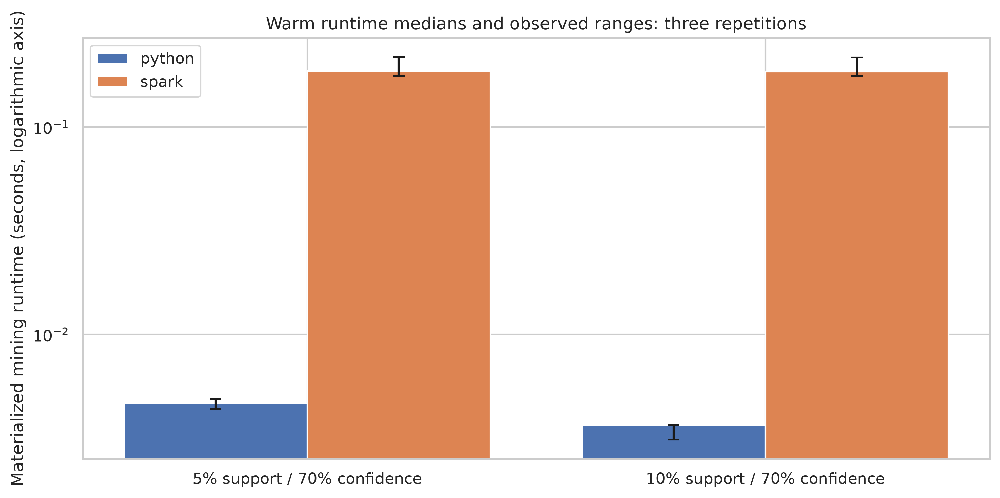
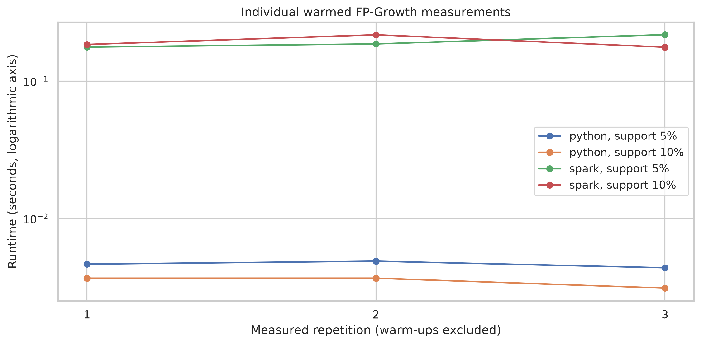

# PySpark FP-Growth: equivalence and benchmark report

## Implementation and comparison scope

We implement Spark ML FP-Growth on the unchanged **437 state-year transactions**, with the same five items per profile and 15-item vocabulary as Phase 6. We instantiate the saved explicit JSON schema, read the original transaction arrays into Spark, repartition into two partitions, cache/materialize them, and verify every profile identity and item array against Python. The frozen Phase 3 contract retains its historical preparation-stage status; this report and the execution record establish Phase 9 runtime verification.

Spark runs on one host with `local[2]`; this is a local multicore experiment, not a multi-machine cluster. Spark's FP-Growth uses parallel pattern growth, while Python uses mlxtend 0.25.0. We collect both `freqItemsets` and `associationRules` to force execution. Spark rules have single-item consequents, so all comparisons use that rule family. Python's complete results remain preserved in Phase 6.

The [executed notebook](../notebooks/07_PySpark.ipynb) runs the experiment and creates both charts directly. The [source module](../src/mining/spark_fp_growth.py) contains Spark configuration, input/output checks, timing and RSS sampling. No second Spark algorithm is implemented here.

## Verified outputs

All **12 support/confidence settings** match Python exactly in itemset identities and integer support counts, and match in single-consequent rule identities. Rule support, confidence and lift agree within absolute tolerance 1e−12. Supports are 5%, 10%, 15%, 20%; confidences are 60%, 70%, 80%.

- Baseline 10% support / 70% confidence: **75 itemsets, zero rules**.
- Exploratory 5% support / 70% confidence: **166 itemsets, four rules**.
- Exploratory 5% support / 60% confidence: **166 itemsets, 16 rules** in the single-consequent family.

All these counts agree with the frozen Python tables. We additionally compare the outputs of each paired measured repetition. See [equivalence.csv](../results/tables/spark_fp_growth/equivalence.csv), the [exploratory Spark itemsets](../results/tables/spark_fp_growth/itemsets_s0p05_c0p70.csv) and [rules](../results/tables/spark_fp_growth/rules_s0p05_c0p70.csv).

## Benchmark protocol

Two scenarios use the actual dataset: baseline 10% / 70%, and nonempty-rule exploratory 5% / 70%. Each engine/scenario has one excluded warm-up and **three measured repetitions**. Engine order alternates between repetitions. We use preloaded Python Boolean membership and cached two-partition Spark input. Timed scope includes FP-Growth fitting, association-rule generation, materialization of both outputs and conversion into canonical Python dictionaries. Disk exports, input loading, validation and plotting are excluded from warmed timing.

Python generates its full confidence-qualified rule family and then restricts to single-item consequents; Spark supplies this restriction natively. This implementation difference is recorded rather than implying identical internal work. Python's implementation is single-process; Spark has two local worker threads. We do not artificially enlarge or replicate transactions.

Speedup is Python median seconds / Spark median seconds. Values below one mean Spark is slower. Minimum and maximum times are retained with every observation in [timing_runs.csv](../results/benchmarks/spark_fp_growth/timing_runs.csv). These are observed ranges, not confidence intervals.

## Actual warmed measurements

| Minimum support (confidence 70%) | Python median seconds | Spark median seconds | Speedup (Python / Spark) | Spark / Python time |
| --- | --- | --- | --- | --- |
| 5% | 0.004644 | 0.186462 | 0.02491 | 40.15 |
| 10% | 0.003667 | 0.184746 | 0.01985 | 50.38 |

Spark is approximately **40–50 times slower** in the observed warmed medians. There is **no performance enhancement** on this dataset. The workload is too small to offset Spark's job, JVM, scheduling and output-collection overhead. This result does not establish how either implementation would scale on larger data.





The logarithmic runtime axes are labeled explicitly because Python and Spark timings differ substantially. All repetitions, including excluded warm-ups, are retained.

## Startup and cold scope

Observed Spark session/JVM startup: **2.7938 s**. Cached input preparation plus transaction validation: **1.7848 s**. First materialized baseline mining job: **0.7941 s**. Their sum is **5.3727 s**.

This is one cold-session observation, not a repeated cold benchmark. It excludes package imports and operating-system process startup, and includes input-equivalence checking within preparation. We do not compare it with a Python cold speedup or mix it into warmed median ratios.

## Hardware, configuration and memory

- CPU: 12th Gen Intel(R) Core(TM) i5-12500H; 12 physical / 16 logical CPUs reported.
- Host RAM: 14.80 GiB reported.
- Python 3.14.4; PySpark 4.3.0; Java 25.0.5.0.3 (Ubuntu).
- Spark master `local[2]`; FP-Growth partitions 2; input partitions 2; SQL shuffle partitions 2; adaptive SQL execution disabled; Spark UI disabled; driver heap configuration 1 GiB.

The [environment/protocol record](../results/benchmarks/spark_fp_growth/environment_and_protocol.json) preserves the effective Spark configuration and input hashes. Successful execution validates this DataFrame/JVM pipeline on the installed environment; it does not prove compatibility of untested Python-worker UDFs, Arrow or pandas-on-Spark APIs.

RSS is sampled every 20 ms. Python measurements include the Python driver only; Spark measurements include that driver and recursively discovered child processes, including the JVM. Per-run baseline and sampled peak footprints are saved in the timing table. Retained heaps, shared pages, sampling gaps and the active Spark session prevent attributing these values solely to algorithm allocations. No memory-efficiency ranking is claimed. Driver heap configuration is not actual resident memory usage.

## Reproduction and verification

```bash
.venv/bin/python -m src.utils.execute_notebook notebooks/07_PySpark.ipynb
.venv/bin/python -m unittest discover -s tests -q
```

For mining tables and benchmark records without notebook figures: `.venv/bin/python -m src.mining.spark_fp_growth`. Re-running measures a new experiment and may change times; output equivalence, not identical timing values, is the reproducibility criterion. The script stops its Spark session in a `finally` block. Both Jupyter and local Spark require local socket access.

Outputs are under [results/tables/spark_fp_growth](../results/tables/spark_fp_growth/) and [results/benchmarks/spark_fp_growth](../results/benchmarks/spark_fp_growth/). PySpark 4.3.0, Py4J 0.10.9.9 and psutil 7.2.2 are pinned. The PySpark archive was verified against official PyPI SHA-256 metadata after a network timeout; installation-source differences do not replace the actual package or dataset.

## Limitations and conclusion

Only one host, two Spark threads, three warmed repetitions per setting and a very small fixed dataset are measured. Input representations necessarily differ between pandas Boolean membership and Spark arrays; output materialization is included on both sides. Cold timing has only one observation. RSS footprints are not isolated allocation measurements. State-year dependence and exploratory binning still limit substantive rule interpretation.

Spark FP-Growth is correctly executed and equivalent to the Python reference in the compared output family. The actual measurements show a slowdown, which we report without claiming the assignment's anticipated performance enhancement. Phase 10 requires a separate faithful Spark K-Medoids implementation and comparison; K-Means has not been substituted.

## References

- Apache Spark 4.3.0 [frequent-pattern mining](https://spark.apache.org/docs/latest/ml-frequent-pattern-mining.html) and [installation](https://spark.apache.org/docs/latest/api/python/getting_started/install.html).
- [Python FP-Growth results](fp_growth.md) and [transformation methodology](data_transformation.md).

Verification: **73 project tests pass**, all **5 notebook code cells** execute successfully, and two charts are generated directly. All **85 raw/prepared inputs** and recorded earlier mining outputs remain unchanged. See the [verification record](../results/benchmarks/spark_fp_growth/verification.json).

The specific pandas ≥3 compatibility FutureWarning is filtered only while running the verified JSON/row pipeline in the notebook. Dependency versions are unchanged; this does not resolve pandas integration compatibility or suppress other warnings/errors. Tables, charts and timing summaries were refreshed after rerunning the cell.

The specific pandas ≥3 compatibility FutureWarning is filtered only while running the verified JSON/row pipeline in the notebook. Dependency versions are unchanged; this does not resolve pandas integration compatibility or suppress other warnings/errors. Tables, charts and timing summaries were refreshed after rerunning the cell.
