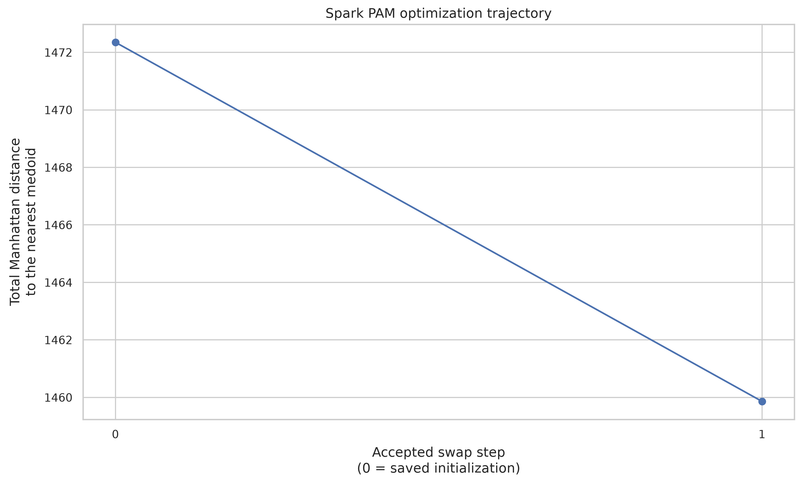
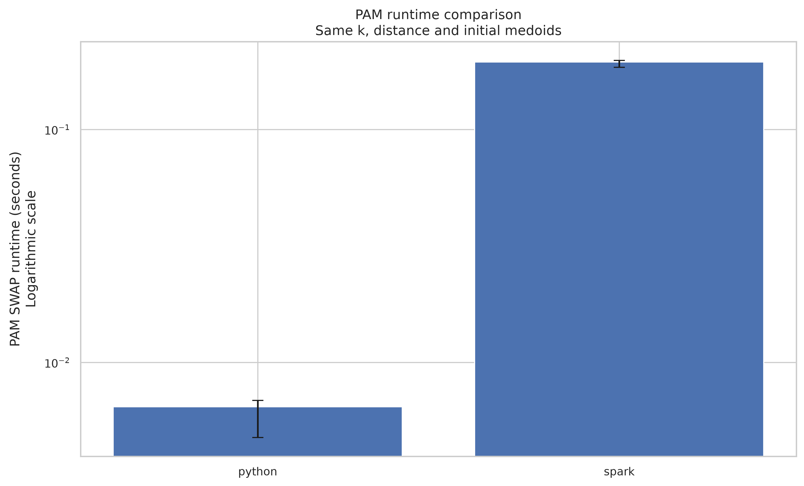

# Second Spark algorithm: faithful PAM K-Medoids

## Task and scope

We implement PAM K-Medoids with distributed distance, assignment and candidate-swap calculations. K-Means is not used. We retain the **437 profiles**, five frozen standardized features, **k=2**, **Manhattan distance**, tolerance **1e−10**, and 100-swap limit from Phase 7. Both implementations start from the same saved observations: **Jharkhand–2007 and Rajasthan–2011**. This is the selected Phase 7 initialization, not the already optimized final medoids.

The separate [executed notebook](../notebooks/08_PySpark_KMedoids.ipynb) allows Phase 10 to run without replacing Phase 9 timing measurements. The [source module](../src/mining/spark_k_medoids.py) performs the actual Spark algorithm. The original `07_PySpark.ipynb` retains Phase 9 FP-Growth. This notebook split is a justified extension of the initial structure for independent, faster experiment execution.

## Distributed implementation

Spark reads the explicit saved numeric-input schema and verifies exact profile/vector equality. We broadcast the small feature matrix; workers compute and cache their own indexed pairwise distance rows. Each iteration uses `mapPartitions` to evaluate assignments and every possible medoid/nonmedoid swap over that partition's observations. Workers return partial objective values and swap-cost tables. The driver sums these partition aggregates, selects the best improving swap with the same tolerance/tie order as Python, and repeats. Final assignments and distances are also evaluated by workers and collected.

The Python reference uses the same nearest/second-nearest distance formula with its prepared distance matrix. Both engines receive the same fixed initialization and optimize the same sum-of-distances objective. BUILD initialization and cluster-count selection are inherited from Phase 7, not benchmarked again. Spark is not merely loading data before fitting a Python model on the driver: its workers calculate all observation-level swap costs and assignments.

The experiment uses two local Spark threads and two RDD partitions, not multiple machines. Broadcasting the complete small feature matrix, O(n²) distance storage and an O(k n) driver aggregate table limit scalability. This is a faithful small-data distributed implementation of the declared PAM SWAP procedure, not a claim of an optimized large-scale package.

## Output equivalence and actual results

We compare the saved selected initialization and a second random initialization using seed 42. Both agree with Python in medoid identities, partitions (ARI **1.0**), assignments/distances, objective and every accepted swap. At every visited medoid set, the entire worker-aggregated candidate-swap table is compared against the independent Python vectorized table.

For the selected initialization:

- Initial objective: **1472.351595489861**.
- One accepted swap replaces Rajasthan–2011 with Kerala–2002.
- Final medoids: **Jharkhand–2007 and Kerala–2002**.
- Final objective: **1459.862365094**; silhouette **0.174477**.
- Maximum candidate-cost difference over both validation starts: **2.274e−12**, below the 1e−9 verification tolerance. Assignment distances match exactly in the observed runs.

The reduction-order discrepancies are floating-point effects; they did not change decisions under the 1e−10 stopping/tie tolerance. The final result has no improving one-medoid swap under that rule. This does not prove a global optimum. Spark labels follow sorted medoid indices and can permute Phase 7's occupancy-ordered labels; medoid IDs and ARI establish equivalence. The weak separation and initialization sensitivity reported in Phase 7 remain limitations, not improved predictive accuracy.

See [equivalence.csv](../results/tables/spark_k_medoids/equivalence.csv), [medoids](../results/tables/spark_k_medoids/medoids.csv), [assignments](../results/tables/spark_k_medoids/cluster_assignments.csv) and [objective trace](../results/tables/spark_k_medoids/objective_trace.csv).



## Benchmark protocol

Each engine has one excluded warm-up and **three measured repetitions**, alternating engine order. Both start with prepared/cached pairwise distances and the same saved medoid indices. Timed scope includes all PAM SWAP evaluations, convergence checks, final assignments and result materialization. Distance preparation, BUILD, validation, plotting and exports are outside the warmed timer. This is a matched SWAP-stage comparison, not total model-selection runtime.

| Engine | Warm median seconds | Observed minimum | Observed maximum |
| --- | --- | --- | --- |
| Python | 0.006449 | 0.004758 | 0.006879 |
| Spark | 0.194666 | 0.184895 | 0.197901 |

Speedup = Python median / Spark median = **0.033129**. Spark is **30.19 times slower** in this observed small-data experiment. There is no performance enhancement. Worker scheduling, serialization and aggregation overhead outweigh parallel computation for 437 profiles. Error bars display min–max ranges, not statistical confidence intervals.



The [raw timing records](../results/benchmarks/spark_k_medoids/timing_runs.csv) retain warm-ups, repetitions, objectives, swap counts and RSS observations. [timing_summary.csv](../results/benchmarks/spark_k_medoids/timing_summary.csv) contains the arithmetic used above. Repeated execution can change runtimes; each measured Python/Spark pair is validated for output equivalence.

## Startup, hardware and memory

Observed session startup is **2.9222 s**. Spark input verification and distributed distance-cache preparation take **2.1491 s**; the first Spark fit takes **0.7185 s**. Their sum is **5.7898 s**. This is one cold-session observation, excluding package imports and process launch; no repeated cold speedup is claimed. Python distance preparation is separately recorded.

The host is 12th Gen Intel(R) Core(TM) i5-12500H, reporting 12 physical / 16 logical CPUs and 14.80 GiB RAM. Software: Python 3.14.4, Spark 4.3.0, Java 25.0.5.0.3. Spark uses `local[2]`, two partitions and a 1 GiB configured driver heap. The full [environment/protocol record](../results/benchmarks/spark_k_medoids/environment_and_protocol.json) includes effective configuration, seeds/initial medoids, feature order and input hashes.

RSS samples use a 20 ms interval: Python driver only for Python runs; driver plus recursively discovered children, including JVM and Python workers, for Spark. These are resident process footprints, not isolated algorithm allocations. Retained heaps, shared pages and sampling gaps preclude a memory-efficiency ranking. The driver heap setting is not an RSS measurement.

This phase successfully exercises Spark Python workers using the project environment. It does not establish compatibility for untested pandas UDF, Arrow or pandas-on-Spark APIs. The specific pandas integration FutureWarning is scoped out for this JSON/RDD workflow; other warnings and errors remain visible.

## Reproduction and verification

```bash
.venv/bin/python -m src.utils.execute_notebook notebooks/08_PySpark_KMedoids.ipynb
.venv/bin/python -m unittest discover -s tests -q
```

For tables/benchmark records without notebook figures: `.venv/bin/python -m src.mining.spark_k_medoids`. No dependency is added beyond Phase 9. Worker module imports use the shared project path on this local host; multi-machine deployment would require explicit code/environment distribution. The Spark context is stopped in a `finally` block.

Tests compare partition-aggregated swap costs with direct Python costs, check zero-distance medoid ties, confirm actual medoid/assignment equivalence with Phase 7, verify three repetitions and ratio arithmetic, and inspect notebook execution/inline figures. Both real initializations and all measured repetitions pass integration checks.

## Limitations and conclusion

The experiment uses a single host, a small fixed cohort and three warmed repetitions. It excludes initialization/model selection and distance preparation from the matched core benchmark and discloses those costs separately. Matrix/broadcast storage is quadratic or centralized in the ways described above. Repeated state-years and fixed full-cohort scaling still limit substantive interpretation. ARI is implementation agreement, not classification accuracy; no causal inference is established.

The assignment now has two executed PySpark techniques: FP-Growth and faithful K-Medoids. Both match their Python reference outputs within stated tolerances; both measured comparisons show slowdowns on this dataset. We report that evidence rather than claiming an enhancement. Phase 11 PDF synthesis and Phase 12 final compliance audit remain unimplemented.

## References

- Apache Spark [RDD programming guide](https://spark.apache.org/docs/latest/rdd-programming-guide.html): partition processing, caching and broadcasts.
- [Phase 7 K-Medoids methodology](k_medoids.md) and [Phase 9 FP-Growth comparison](spark_fp_growth.md).

Phase 10 verification: all **78 project tests pass**, all **5 notebook code cells** execute successfully and two charts are generated directly. All **85 raw/prepared inputs** and recorded earlier outputs remain unchanged. See the [verification record](../results/benchmarks/spark_k_medoids/verification.json).

Routine Spark startup messages and console stage progress are disabled by the shared `src/utils/spark-log4j2.properties` configuration and Spark settings. ERROR logging remains active. Both Spark experiments were executed again and their measurements/figures refreshed.
